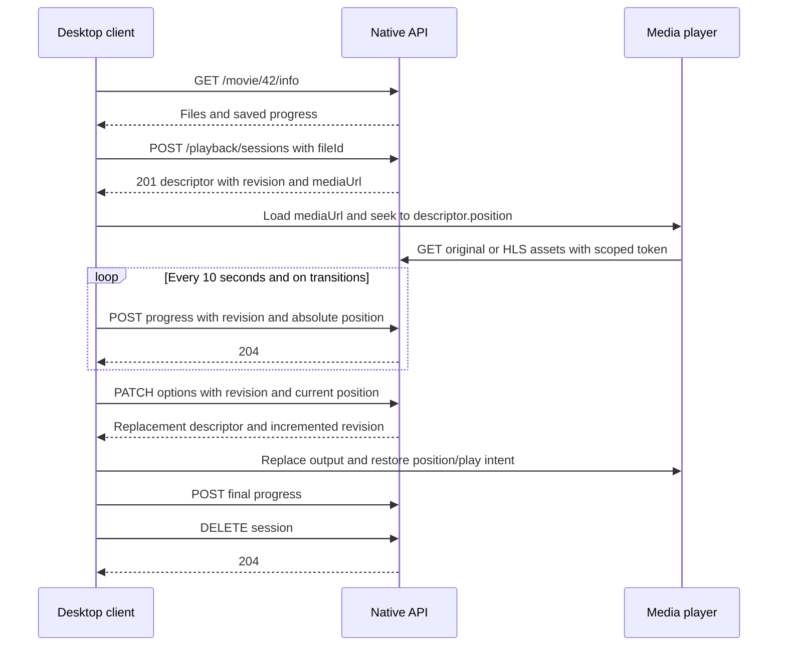

# Building an Oblecto desktop client

A desktop client can implement sign-in, browsing, playback and saved progress entirely through Oblecto's native HTTP API. Socket.IO adds live library updates and remote control. No access to the server filesystem, database, metadata-provider credentials or federation protocol is needed.

Read this guide first, then use the [REST reference](API.md), [endpoint index](API_ENDPOINTS.md), [response models](API_MODELS.md) and [realtime protocol](REALTIME_API.md) as implementation contracts. They describe the current checkout, including unreleased functionality. For an existing Jellyfin client, use the separate [compatibility API](JELLYFIN.md); native and Jellyfin sessions and IDs are not interchangeable.

## Implementation sequence

1. Implement server profiles, an HTTP adapter, defensive error decoding and secure token storage.
2. Implement login options, login and `/api/v1/me`; restore identity and preferences on launch.
3. Implement paginated movie/series browsing, search, detail pages and episode navigation.
4. Add a player adapter that can open direct URLs and HLS, seek in absolute seconds, load WebVTT subtitles and report position/state.
5. Add managed playback sessions, serialized reconfiguration, progress reporting and cleanup.
6. Add saved lists, watched actions, artwork and per-user cache invalidation.
7. Connect Socket.IO for notifications and optionally advertise the app as a remote playback device.
8. Add optional statistics and permission-gated administration. A normal playback client requires no administrative permissions.

Keep the HTTP client, metadata cache, playback session controller, decoder adapter and remote-command receiver separate. This lets native decoders and browser-based desktop shells share protocol behavior without coupling their player APIs.

## Connect and authenticate

Ask for a server URL such as `http://media-server:8080`. Store it per server profile. Port 8080 is the native default, 8096 the optional Jellyfin default. Do not append `/web` or `/api/v1` globally. A public `GET /auth/login-options` can check reachability and describe available local-network profiles. There is no native server-discovery endpoint; `/api/v1/system/info` requires login.

The profile picker is conditional. Always support username/password entry. Only omit the password when the returned profile has `passwordless: true`; network locality is decided by the server, not the desktop's address heuristic.

```http
POST /auth/login
Content-Type: application/json

{"username":"alice","password":"example-password"}
```

```json
{"accessToken":"eyJ..."}
```

Then call `GET /api/v1/me` with `Authorization: Bearer eyJ...`. Persist the token in an OS credential store, keyed by server and account; keep ordinary preferences/device identity in app storage. Do not use JWT profile claims as current account state. There is no refresh-token flow. On 401, offer sign-in and retain the selected server. Login 429 includes a retry delay; do not repeatedly retry credentials.

On sign-out or account switch, flush final progress, stop managed sessions, disconnect realtime, and discard account-specific caches. Native logout is local token removal; it does not revoke other copies. A password change invalidates the current token as well as other tokens, so sign in again after changing it.

Use HTTPS when provided by the deployment. In an Electron renderer or webview, configure the app's origin in `server.corsOrigins`, or make API calls through the app's native network layer. Socket.IO connectivity alone does not establish that REST CORS is configured.

## A small HTTP adapter

This JavaScript example uses standard `fetch`. It preserves a deployment prefix, handles empty/non-JSON responses, and keeps media URL handling separate from authenticated JSON calls. Integrate cancellation, timeouts and credential storage in the desktop host. The adapter does not retry mutations automatically.

```javascript
export class OblectoApi {
  constructor(baseUrl, token = null) {
    this.base = new URL(baseUrl);
    this.base.search = "";
    this.base.hash = "";
    this.base.pathname = this.base.pathname.replace(/\/?$/, "/");
    this.token = token;
  }

  url(path, query = {}) {
    // API paths below are trusted relative paths from this protocol.
    const url = new URL(path.replace(/^\/+/, ""), this.base);
    for (const [key, value] of Object.entries(query)) {
      if (value == null) continue;
      for (const part of Array.isArray(value) ? value : [value]) {
        url.searchParams.append(key, String(part));
      }
    }
    return url;
  }

  mediaUrl(path) {
    const url = /^[a-z][a-z0-9+.-]*:/i.test(path)
      ? new URL(path) : this.url(path);
    if (url.origin !== this.base.origin) throw new Error("Unexpected media origin");
    return url.href; // Preserve the session token in the query string.
  }

  async request(method, path, { query, body, signal, auth = true } = {}) {
    const headers = { Accept: "application/json" };
    if (auth && this.token) headers.Authorization = `Bearer ${this.token}`;
    if (body !== undefined) headers["Content-Type"] = "application/json";
    const response = await fetch(this.url(path, query), {
      method, headers, signal,
      body: body === undefined ? undefined : JSON.stringify(body)
    });
    const raw = response.status === 204 ? "" : await response.text();
    let data;
    try { data = raw ? JSON.parse(raw) : undefined; }
    catch { data = raw; }
    if (!response.ok) {
      const detail = data && typeof data === "object" ? data : {};
      const error = new Error(detail.message || detail.error || `HTTP ${response.status}`);
      Object.assign(error, {
        status: response.status, code: detail.code, fields: detail.fields,
        retryAfter: response.headers.get("Retry-After")
      });
      throw error;
    }
    return data;
  }
}
```

Do not send the access token to trailer providers or artwork URLs on unrelated origins. Media URLs already carry a scoped token; preserve it on all HLS requests and avoid logging it. Reverse proxies must expose both API and media paths and handle relative HLS assets consistently. Validate the entered base URL as HTTP/HTTPS in the server-profile UI.

Example login and one browse page:

```javascript
const api = new OblectoApi("http://localhost:8080");
const login = await api.request("POST", "/auth/login", {
  auth: false, body: { username, password }
});
api.token = login.accessToken;
const me = await api.request("GET", "/api/v1/me");
const page = await api.request("GET", "/movies/list/movieName", {
  query: { mode: "browse", order: "asc", count: 40 }
});
// page.items; page.pageInfo.nextCursor; me.preferences; me.permissions
```

## Build the library screens

| Screen | Requests |
| --- | --- |
| Home | `/movies/watching`, `/episodes/watching`, `/episodes/next`; optional recent lists sorted by `createdAt` descending |
| Movies | `/movies/list/movieName?mode=browse&order=asc`; follow `pageInfo.nextCursor` |
| TV | `/series/list/seriesName?mode=browse&order=asc` |
| Saved lists | The same browse routes with `list=favourites` or `list=watchlist` |
| Search | Browse `q` for movies/series; `/episodes/search/:name` and `/people/search/:name` for other kinds |
| Movie detail | `/movie/:id/info`; independently load `/extras`, `/sets`, `/related` |
| Series detail | `/series/:id/info`, `/series/:id/episodes`; optionally `/extras`, `/sets`, `/related` |
| Episode detail | `/episode/:id/info`, `/episode/:id/context` |
| Person | `/person/:id/info`, `/person/:id/profile` |
| Account | `/api/v1/me`, account PATCH/password/avatar routes |
| History | `/api/v1/statistics/me/history` and `/summary` |

Movie/series browse returns `{ items, pageInfo, appliedFilters, facets }`. Keep sort, order and filters fixed when following cursors. On a filter change, cancel/discard old requests and start without a cursor. Page numbers do not advance browse queries. There is no global search endpoint or universal total count. The older `/.../search/:name` routes are unpaged (people have a bounded count).

Represent absent associations separately from empty arrays. A movie browse card without `Files` still needs detail lookup before concluding it cannot play. Detail `Files: []` means no linked source. Group episode lists into seasons and sort numeric aired values on the client; do not rely on the server's legacy string ordering.

Read watch progress from `TrackMovies[0]` or `TrackEpisodes[0]`, not a `watched` field on the media model. Null/absent tracks mean no progress. A useful resume rule is positive time and progress between 0 and 0.9. The resume shelves cover the last seven days; the history API has different retention. Series browse `watched` means at least one watched episode, not every episode.

Movie `genres` and series `genre` can be encoded text; series detail can return an array. Normalize them once in the adapter. Ratings, dates and titles may be missing. Avoid displaying null scores as zero or interpreting absent certifications as unrestricted viewing. Keep details usable when `/extras` fails.

Artwork URLs can be constructed from native IDs, for example `/movie/42/poster?size=medium`. Cache by server, kind, ID and size; invalidate after artwork notifications/uploads. Avatar URLs should include `?v=` with the current `avatar` value. Fall back to placeholders on missing files. Honour `episodeSpoilers` in the client presentation; the API still returns full metadata.

## Start and control playback



### Choose a source and capabilities

Fetch movie or episode info and present available `Files`. Use the chosen **file ID**, not the movie or episode ID. When there are multiple versions, show useful stream details and remember the user's choice; no API promises the first file is preferred.

Advertise what the actual decoder/output device supports. Container names currently match the lowercase file extension (`mp4`, `m4v`, `mkv`), while codecs use FFprobe names (`h264`, `hevc`, `aac`), not MIME codec strings. `profiles` match source profile names. `maxLevel` uses FFprobe's convention (for example H.264 42); codec families can use different scales. Avoid overclaiming capabilities to obtain direct playback.

Conservative H.264/AAC example, valid only if the player's HLS support is available:

```javascript
const detail = await api.request("GET", "/movie/42/info");
const file = detail.Files.find(file => file.id === selectedFileId);
if (!file) throw new Error("Choose an available file");
const track = detail.TrackMovies?.[0];
const resume = track?.time > 0 && track?.progress > 0 && track.progress < 0.9
  ? track.time : 0;
let session = await api.request("POST", "/playback/sessions", {
  body: {
    fileId: file.id,
    position: resume,
    quality: me.preferences.quality,
    subtitleMode: me.preferences.subtitleMode,
    capabilities: {
      containers: ["mp4", "m4v"], videoCodecs: ["h264"], audioCodecs: ["aac"],
      profiles: ["Baseline", "Constrained Baseline", "Main", "High"],
      maxLevel: 42, maxBitDepth: 8, maxAudioChannels: 2, maxHeight: 1080,
      hdr: false, nativeTracks: false, hls: true
    }
  }
});
const source = api.mediaUrl(session.mediaUrl);
// Load source in your player, then seek to session.position when ready.
```

Apply language preferences by mapping `Files[].Streams[].tags_language` to source `index`, then sending `audioStreamIndex`/`subtitleStreamIndex`. Omission uses server selection; the server does not automatically apply `/me` preferences. `null` disables a track; `-1` is invalid. `subtitleMode: "off"` disables subtitles even if an index was supplied.

`nativeTracks: true` means the player can honor track selection while receiving the unmodified file. For direct delivery, select the corresponding native audio track yourself; otherwise advertise false so the server can remux the chosen track. Attach `subtitleUrl` as WebVTT when present, without duplicating an HLS subtitle rendition. ASS/SSA and bitmap subtitles can require video rendering. Use descriptor `selectedTracks` as the result of negotiation.

`original` requests compatible original delivery with remux/transcode fallback; it is not a guarantee of direct play. `auto`, numeric quality or `maxBitrate` selects adaptive output. `direct` delivers the original file with byte-range support; `remux` and `transcode` deliver HLS. A player with `hls: false` can receive 422 when conversion is needed. Actual segment encoding is on demand; allow preparation time rather than treating the 201 descriptor as fully buffered media.

### Positions and reconfiguration

All native positions are **absolute seconds**, including HLS after a seek or track/quality change. Set the player's initial seek from `session.position`; do not add an offset to subsequent player timestamps. Ordinary seeks operate on the player's direct/HLS source, then report progress. They do not require a new session.

For quality or track changes, serialize this sequence:

1. Capture current player position and play/pause intent; flush queued progress.
2. Pause periodic reporting while replacing the source.
3. PATCH with the current revision and explicit current position.
4. Replace media/subtitle URLs with those from the response, restore absolute position and local play intent, then resume reporting using the new revision.

```javascript
session = await api.request("PATCH", `/playback/sessions/${session.sessionId}`, {
  body: { revision: session.revision, position: currentPosition, quality: 720 }
});
```

Explicit position matters: omitted PATCH position can reuse the original option even after progress has advanced. Do not submit parallel PATCH requests with the same revision. Old media URLs return 409 after a revision change (thumbnail sheets are the exception). Create a new session to change files.

A late create/update response must not replace a newer playback choice. Use a monotonically increasing local generation or equivalent state guard; dispose of obsolete sessions whose creation succeeded. HTTP cancellation alone does not guarantee the server undid a creation.

### Persist progress and viewing telemetry

Send this every ten seconds, on play/pause/buffering transitions, after seek completion, and before stop/end:

```javascript
await api.request("POST", `/playback/sessions/${session.sessionId}/progress`, {
  body: {
    revision: session.revision,
    position: currentPosition,
    paused: isPaused,
    buffering: isBuffering
  }
}); // 204, no JSON body
```

Keep sending paused heartbeats if the session should remain available. GET descriptor polling does not extend its idle lease. Media requests, updates and progress touch the lease; default idle expiry is 30 minutes. Server restart discards sessions. Desktop sleep can outlast the lease; recreate from the last local absolute position on 404.

For more accurate statistics, also send cumulative `activeSeconds`, `playedRanges` and increasing `sequence`, plus `playbackRate`. Sample a monotonic clock; count active wall time only while media advances, and never claim a seek gap as viewed coverage. Merge ranges, at most 1024 pairs. Keep counters across revisions; reset for a new session. Send `failed: true` once for a terminal client error. Optional telemetry validation does not replace ordered resume writes: queue progress requests serially and stop obsolete producers.

On close/stop/end, await final progress **before** DELETE. Deletion alone saves no new position. Dispose the decoder/HLS instance and event listeners, clear timers, and publish realtime idle. Repeated DELETE succeeds with 204; deleting another user's live session returns 404. If the app crashes, the lease eventually releases resources.

### Recover without retry loops

| Failure | Recovery |
| --- | --- |
| Direct source cannot decode or stops advancing | Once per playback attempt, PATCH current position with `forceHls: true, quality: "auto"`; retain capabilities |
| HLS network interruption | Bounded backoff; report buffering; preserve absolute position |
| 409 stale revision | Stop obsolete work, GET descriptor, then reconcile or recreate; never keep using old URLs |
| 404 session unavailable | Create a new session for the chosen file at the last known position |
| 401 media access | Check session with authenticated GET; recreate if needed. A media-token failure is not automatically an account logout |
| 401 control request | Sign in again, then restore playback with a fresh session |
| 422 unsupported media | Surface the explanation; choose another file or correct capabilities/options |
| 503 capacity / 504 preparation timeout | Show a retry action; respect retry delay when available and limit automated attempts |

To undo fallback, explicitly set `forceHls: false` along with `quality: "original"`. Mutations merge existing options; omitted values do not reset them. `maxBitrate` has no null/reset value, so create a new session without it to remove that constraint. Track/bandwidth changes should preserve the user's paused state locally.

## Chapters and automatic continuation

Use descriptor chapters for navigation and segments for skip buttons. A skip seeks to segment `end`. Use authorized trickplay sheets and the [thumbnail grid calculation](API_MODELS.md#playback-descriptors-and-markers) for seek previews. Empty markers/null trickplay are normal, especially before analysis and for remote files. Do not delay playback waiting for analysis.

Use episode context for numeric adjacency and `nextUnwatched`, then fetch the candidate's info and choose its file. Honour `autoplayNext` and `stillWatchingPrompt`. The native web behavior asks before continuing after 90 minutes without interaction; a desktop client implements that policy locally. Trigger a countdown at terminal credits if known; do not skip post-credit scenes. Without markers, the web client uses a final 30-second lead. The library's watched threshold is not an autoplay trigger.

## Realtime updates and remote playback

Use a **Socket.IO 4-compatible client**, not a plain WebSocket implementation. Connect to the native server, default namespace, default path `/socket.io/`; prefix the path for a proxy deployment. Use a persistent per-installation device ID. Two simultaneous sockets with the same ID cause the older one to disconnect; multi-window apps should share one connection or use distinct persisted window/device identities.

```javascript
import { io } from "socket.io-client";

const socket = io(api.base.origin, {
  path: `${api.base.pathname}socket.io/`,
  autoConnect: false,
  auth: callback => callback({
    token: api.token,
    device: { id: savedDeviceId, name: savedDeviceName, capabilities: ["control", "playback"] }
  })
});
socket.on("indexer", event => scheduleLibraryRefresh(event));
socket.on("media:progress", event => mergeSavedProgress(event));
socket.on("devices", devices => replaceDeviceList(devices));
socket.on("connect", () => refreshVisibleResources());
socket.on("connect_error", error => showConnectionError(error.message));
socket.on("remote:command", async ({ command }, ack) => {
  try {
    await acceptPlayerCommand(command); // App-defined; accept promptly, queue long preparation.
    ack({ ok: true });
  } catch (error) {
    ack({ ok: false, code: "failed", error: String(error.message || error) });
  }
});
socket.connect();
```

The callbacks in this example are application integration points. `play` carries a movie/episode reference, **not a file or media URL**: fetch details, choose a source, and create a session through the same local playback controller. `position` is optional. Accept or reject within the server's five-second acknowledgement deadline; report subsequent loading/playback failures in `playback:state`. Do not send an unconditional success without accepting the action. Handle pause, resume, stop, seek, volume, mute, next and rename explicitly; persist renames for reconnect.

Only advertise `playback` once the app implements the receiving commands. Send `playback:state` on transitions and about once per second while playing (server limit: 10/s). It includes media identity, status, position, duration, volume, muted and capability flags. `updatedAt` is server-stamped. Send `blocked` when user interaction is required to start playback. These socket reports **do not save progress**; HTTP reporting remains mandatory.

Device lists are caller-scoped. Use `deviceId`, never `socket.id`, as a target. Keep a local/remote playback-target selector explicit; commands to a remote target should not start local playback. `ok: true` means the target accepted the command, not that it finished decoding the first frame. Socket events are not replayed after disconnect: refetch visible lists/details/saved progress on reconnect. Coalesce library notifications to avoid a request per indexed item. Favourites/watchlists have no dedicated native realtime event; update from mutation responses and refresh relevant resources on focus/reconnect.

## Optional administration

Read effective permissions from `/api/v1/me`. Show library tools only for `libraries.manage`, system jobs/imports for `system.manage`, settings/federation for `settings.manage`, users/groups for `users.manage`, and server statistics for `statistics.view`. Permissions can change while a token remains valid; handle 403 and refresh account state.

Maintenance returns a job with HTTP **200**; poll `/api/v1/system/maintenance/jobs` while visible. Jobs are in-memory and cannot be cancelled. Settings PATCH persists before returning but some services require restart to use changed settings. Provider-test failures can be HTTP 200 with `ok: false`. Federation setup is an administrator workflow; ordinary federated playback still uses the standard session API on the user's server.

## Client acceptance checklist

- Connect to direct and proxy-prefixed URLs; restore a valid login; recover from expiry/password change; handle unavailable servers and non-JSON errors.
- Browse more than one page; change filters with old requests in flight; render null metadata; switch accounts without leaking cached progress/lists.
- Sort season/episode numbers 1, 2 and 10 correctly; keep specials separate; handle a title with no playable files and missing artwork.
- Play a compatible original, a remux and a transcode; resume, seek backwards/forwards, change source, audio, subtitles and quality while both playing and paused.
- Check absolute timeline after each revision, single fallback to HLS, slow segment preparation, network loss, server restart and desktop sleep beyond expiry.
- Verify progress from a second client; flush final progress before stop; distinguish saved position, watched state and statistics coverage.
- Exercise chapter seeks, missing markers, thumbnail grids, intro skips, post-credit scenes and autoplay preferences.
- Connect two devices for one account and one for another; verify caller-scoped lists, target acknowledgement/timeout, stable IDs, duplicate-ID displacement and reconnect refresh.
- Reject unauthorized administration gracefully; preserve field-validation errors and render asynchronous jobs without treating acceptance as completion.

Useful implementation references: [web playback controller](../Oblecto-Web/src/playback/PlaybackController.js), [viewing telemetry](../Oblecto-Web/src/playback/PlaybackTelemetry.js), [remote receiver](../Oblecto-Web/src/remote/receiver.js), [HTTP client library](../Oblecto-Web/src/oblecto-client/src), [playback service](../src/lib/playback/PlaybackService.ts). These are examples, not additional API requirements. Removed `/session/create`, `/session/stream`, `/HLS`, `/clients` and REST remote-command routes must not be used by a new client.
